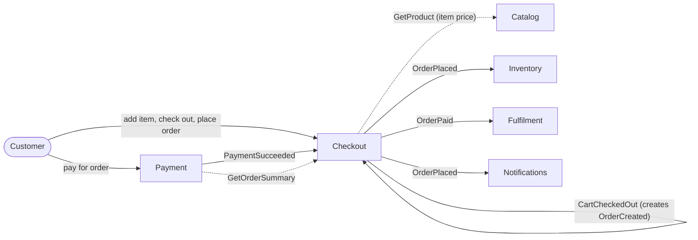
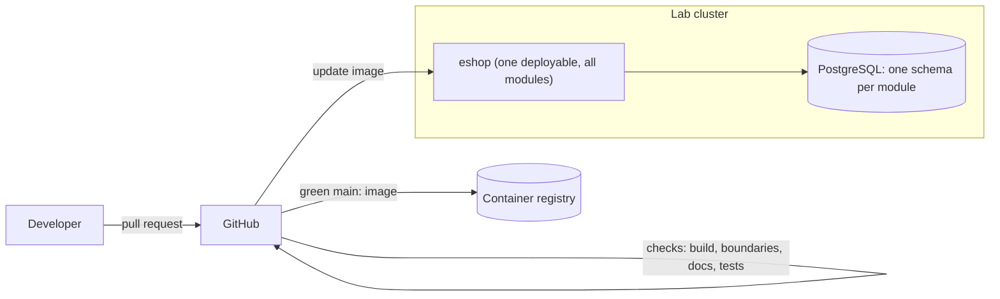

# E-shop architecture

The current state of the system. The reasoning behind each structural choice is in the
[ADRs](adr/README.md); this page says what the system looks like now. When a change makes this
page wrong, the same pull request fixes it.

## 1. Goal

An online shop: customers browse a catalog, fill a cart, place an order and pay for it; the
warehouse reserves stock and packs paid orders; customers are told what happened. Two teams build
it in parallel and run it as one system, on a small lab cluster, with every green `main` deployed
within minutes.

The architecture is the borders between the parts. Inside a border, the owning team decides.

## 2. Constraints

- Two teams and one instructor build and operate the system; nobody operates it full time.
- One small Kubernetes lab cluster with one PostgreSQL database; no message broker.
- Node.js and NestJS; the repository is the single source of code, decisions and documentation.
- Both teams merge to the same `main` all day; there is no staging environment
  ([0007](adr/0007-deploy-every-green-main.md)).

## 3. Quality goals

| Priority | Quality       | What it means here                                                                             |
| -------- | ------------- | ---------------------------------------------------------------------------------------------- |
| 1        | Modifiability | A team changes the inside of its module without asking the other team.                         |
| 2        | Evolvability  | Any module can later be lifted out into its own service without untangling code or tables.     |
| 3        | Operability   | The whole system runs with one database and one process; one order can be followed end to end. |
| 4        | Deployability | A merged change reaches the running system within minutes, without a person in the path.       |

## 4. Context map

Six bounded contexts are built, one module each
([0003](adr/0003-module-borders-follow-bounded-contexts.md)). Solid arrows are events on the happy
path, from the publisher to the module that reacts. Dashed arrows are public queries, from the
asking module to the owner.

The happy path of one order (the cart events carry no `orderId`, so the order's timeline starts
at `OrderCreated`):

1. Checkout: `ItemAddedToCart`, `CartCheckedOut`, `OrderCreated`, `OrderPlaced`
2. Inventory reacts to `OrderPlaced`: `StockReserved`
3. Notifications reacts to `OrderPlaced`: `OrderSummarySent`
4. Payment, when the customer pays: `PaymentInitiated`, `PaymentSucceeded`
5. Checkout reacts to `PaymentSucceeded`: `OrderPaid`
6. Fulfilment reacts to `OrderPaid`: `OrderPacked`

When stock runs out, Inventory publishes `StockReservationFailed`, Checkout cancels the order
(`OrderCancelled`), Inventory releases anything it held for that order if it held anything (`StockReleased`; with all-or-nothing reservations nothing is held on this path) and
Notifications sends a cancellation notice (`CancellationNoticeSent`). When the payment provider declines, Payment publishes `PaymentFailed`
and the order stays placed.

Contexts found on the event storming board but not built (Promotions, Identity, Billing, Reviews,
Loyalty, Returns) have no module. The board is a dated snapshot in
[event-storming/](event-storming/README.md); this page and the code are the current model.

## 5. Modules

| Module                                          | Owner      | Schema          | Internal style                           |
| ----------------------------------------------- | ---------- | --------------- | ---------------------------------------- |
| [catalog](../src/catalog/README.md)             | Instructor | `catalog`       | Plain create-read-update service         |
| [checkout](../src/checkout/README.md)           | Team A     | `checkout`      | Team decides                             |
| [inventory](../src/inventory/README.md)         | Team B     | `inventory`     | Team decides                             |
| [fulfilment](../src/fulfilment/README.md)       | Team B     | `fulfilment`    | Team decides                             |
| [payment](../src/payment/README.md)             | Instructor | `payment`       | Ports and adapters, transactional outbox |
| [notifications](../src/notifications/README.md) | Instructor | `notifications` | Thin event reactions                     |

Two shared parts are not modules:

- `src/contracts/` holds every event and public query that crosses a border, and nothing else. It
  imports nothing from the application. A change here is reviewed by every consuming module.
- `src/platform/` (instructor) provides what every module needs: the database connection and
  per-module migrations, the order timeline, failure injection, and the dev endpoints. Modules use
  it only through `src/platform/index.ts`. Its own data lives in the `platform` schema.

Rules every module keeps:

- **Borders** ([0003](adr/0003-module-borders-follow-bounded-contexts.md)): a module imports only
  its own files, `src/contracts/**`, `src/platform/index.ts` and libraries. The build fails otherwise.
- **Data** ([0004](adr/0004-each-module-owns-its-data.md)): a module reads and writes only its own
  schema and migrates it on its own. No joins, foreign keys or views across schemas.
- **Contracts** ([0005](adr/0005-integration-through-contracts.md)): modules talk only through
  events (facts, published by their owner) and public read-only queries (answered by the owner).
  There are no cross-module commands: a module that reacts to another module's event does so with
  its own policy, issuing its own command, and never re-publishes the incoming event. A module
  does not build a copy of another module's data from its events; it asks the owner with its
  public query, so reads are strongly consistent.
- **Failure injection**: every reaction to an event first calls
  `ChaosService.maybeFail('<PolicyName>')`, so a failure can be injected into any reaction.

The order timeline (`GET /orders/:orderId/timeline`) is a read model the platform builds from
events: it records every order event and every failed reaction in the `platform` schema. It is a
diagnostic view, not a source for decisions, and it is eventually consistent: a read may lag the
events by a moment. Module data is never read this way; a module that needs another module's data
asks the owner with a public query.

## 6. Inside a module

What a module shows to the outside is fixed by sections 4 and 5. What happens inside is the
owning team's choice, recorded in the **Internal architecture** section of the module's README
([0006](adr/0006-internal-architecture-per-module.md)). The effort follows the subdomain: the
simplest thing that works for generic and supporting contexts, the most careful design for the core.

The three instructor modules differ on purpose:

|                  | Catalog                                                      | Payment                                                                          | Notifications                             |
| ---------------- | ------------------------------------------------------------ | -------------------------------------------------------------------------------- | ----------------------------------------- |
| Kind of context  | Supporting                                                   | Supporting, wraps an external provider                                           | Generic                                   |
| Style            | Plain create-read-update service                             | Ports and adapters plus a transactional outbox                                   | Thin event reactions                      |
| Shape            | A controller, a service writing its table, one query handler | `domain/`, `application/`, `adapters/`, `outbox/`                                | Two policy classes and a fake email store |
| Events published | Right after the database write                               | From an outbox written in the same transaction as the state change               | Right after the message is stored         |
| Why              | Almost no rules; anything more would be ceremony             | Keeps the provider's model out of ours; a charged card must never lose its event | Each reaction is a single step            |

Checkout, Inventory and Fulfilment choose their own styles; their READMEs say which and why.

## 7. Deployment view

- One deployable, one process, all six modules plus the platform
  ([0002](adr/0002-modular-monolith-one-deployable.md)). Events and queries are in-process calls.
- One PostgreSQL database with one schema per module and one for the platform. Each module's
  migrations run on start-up and are a no-op when already applied.
- Every pull request runs the full checks and cannot merge red. After a merge, `main` runs them
  again, including the end-to-end happy path (`test/happy-path.e2e-spec.ts`, skipped until all three team modules work and un-skipped then by the instructor at milestone 4); only a green `main` is built into an image and
  rolled out to the lab cluster by a pipeline identity that can update this one application
  ([0007](adr/0007-deploy-every-green-main.md)).
- Locally the application runs with `npm run start:dev` against the PostgreSQL from
  `docker-compose.yml`; see the [README](../README.md).

## 8. Observability

The platform makes the running system observable without any code in the modules
([0009](adr/0009-observe-through-opentelemetry.md)).

- **Traces.** One trace per request. Publishing an event is a span `publish <EventName>`; each
  subscriber runs in `process <EventName>`; command and query handlers are spans named after the
  handler class. Spans carry `app.module`, `app.handler` and, when the event has one,
  `app.order_id`. A handler that throws marks its span as an error and names the handler.
- **Outbox.** Payment's outbox stores the trace context with each row. The relay starts a new trace,
  `outbox.relay <EventName>`, with a link back to the one that wrote the row, so the gap between
  the state change and the delivery is still connected.
- **Logs.** One JSON line per record on stdout, and the same record sent as telemetry. When a span
  is active the record carries `trace_id` and `span_id`, so a log line and its trace point at each
  other. Every HTTP request writes one access log line.
- **Where it goes.** The application exports only when an endpoint is configured
  (`OTEL_EXPORTER_OTLP_ENDPOINT`); otherwise nothing leaves the process. In the lab the telemetry
  goes to the cluster's collector and on to the hosted Grafana. Locally, see "Telemetry locally"
  in the [README](../README.md). Metrics are not exported.
- **What modules must not do.** No tracer, span or telemetry import in a module; log with Nest's
  `Logger` and fields; never put personal data (a customer's email) in a log or on a span. The
  platform redacts known fields as a safety net, not as permission.

## 9. Decisions

| ADR                                                        | Decision                                                            |
| ---------------------------------------------------------- | ------------------------------------------------------------------- |
| [0001](adr/0001-record-architecture-decisions.md)          | Record architecture decisions as ADRs in the repository             |
| [0002](adr/0002-modular-monolith-one-deployable.md)        | Modular monolith, one deployable                                    |
| [0003](adr/0003-module-borders-follow-bounded-contexts.md) | Module borders follow the bounded contexts, enforced by lint        |
| [0004](adr/0004-each-module-owns-its-data.md)              | Each module owns its data                                           |
| [0005](adr/0005-integration-through-contracts.md)          | Modules integrate only through contracts: events and public queries |
| [0006](adr/0006-internal-architecture-per-module.md)       | Internal architecture is each module's own choice                   |
| [0007](adr/0007-deploy-every-green-main.md)                | Deploy every green `main` automatically                             |
| [0009](adr/0009-observe-through-opentelemetry.md)          | Observe the system through a vendor-neutral telemetry standard      |

The [ADR index](adr/README.md) has the status of each.

## 10. Open questions

- **What happens to an event when its handler fails?** Delivery is in-process. Today a reaction
  that throws is reported (it shows as `handler_failed` on the order's timeline), the application
  keeps running, and the chain for that order stops there: the event is not retried and the
  publisher's change is not rolled back. Payment's outbox already delivers its events at least
  once, so its subscribers can see a duplicate. Whether events may be lost, must be retried, or
  must be handled exactly once is not decided. This is ADR 0008 (open).
