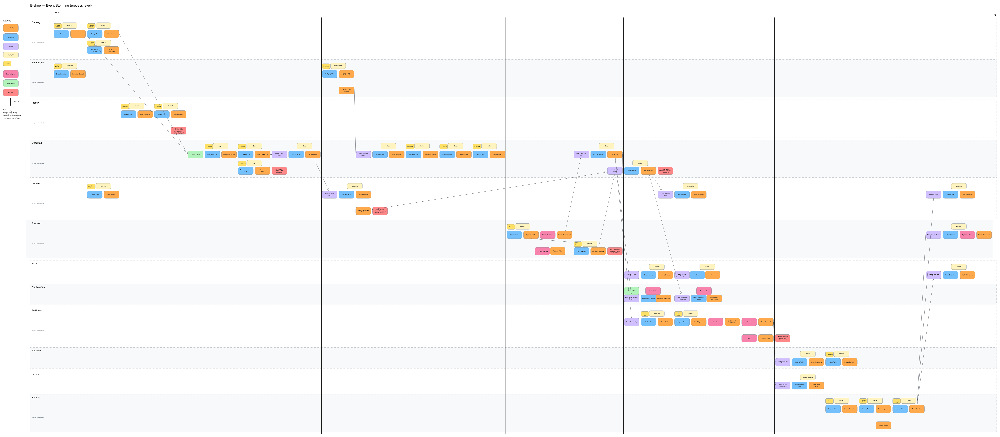

# Event storming board

Snapshot from the Seminar 03 event storming session (2026-11). Not maintained: the code and
[docs/architecture.md](../architecture.md) are the current model.

- [eshop-board.png](eshop-board.png): the board as an image.
- [eshop-board.excalidraw](eshop-board.excalidraw): the board itself; open it at
  [excalidraw.com](https://excalidraw.com) (menu, Open).

The board is where the bounded contexts and the ubiquitous language were first written down. Names
of events, policies and queries in the code come from it (`Stock Reserved` became
`StockReserved`), but the board is not updated when the code changes, and the code is not
required to match it ([ADR 0003](../adr/0003-module-borders-follow-bounded-contexts.md)).

## Legend

| Sticky colour                 | Meaning                                                             |
| ----------------------------- | ------------------------------------------------------------------- |
| Orange                        | Domain event: a fact, in the past tense                             |
| Blue                          | Command: an intention, issued by an actor or a policy               |
| Purple                        | Policy: "whenever this event, then that command"                    |
| Pale yellow                   | Aggregate: the thing that accepts the command and records the event |
| Yellow (small, with a figure) | Actor: the person who issues a command                              |
| Pink                          | External system                                                     |
| Green                         | Read model: the information someone needs to decide                 |
| Red                           | Hot spot: an open question or a disagreement                        |

Swimlanes are bounded contexts; time runs left to right. Thick vertical lines mark pivotal events.
